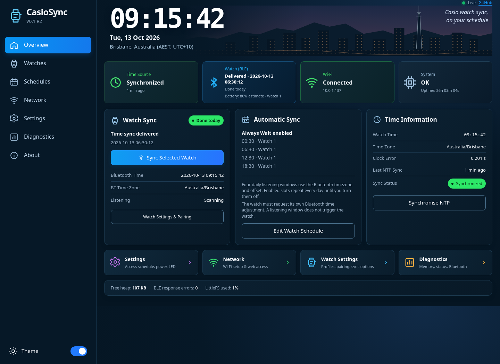
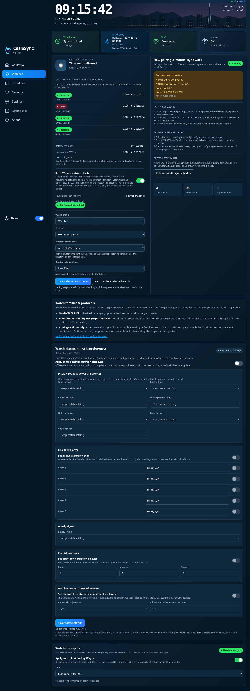
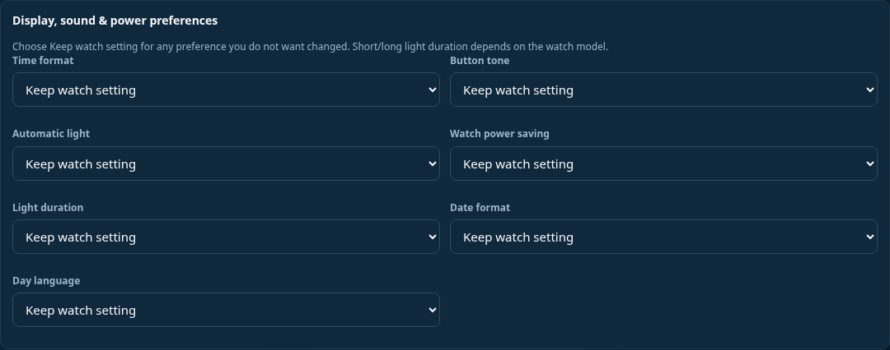
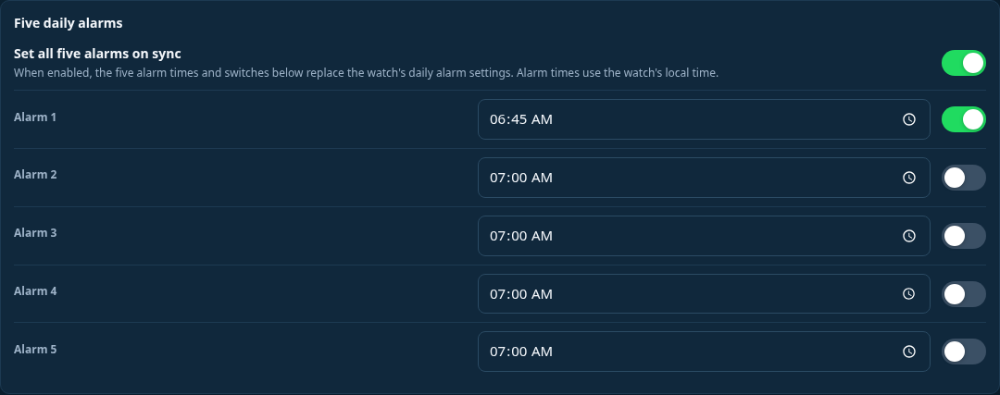

# CasioSync V0.1 R2

CasioSync is an ESP32 Bluetooth companion for Casio watches. It obtains trusted time over Wi-Fi/NTP, listens for watch connections, delivers the selected local time, and can apply optional watch preferences during that connection.

This is a separate project derived from [Time Transmitter V4.16](https://github.com/whitto/time-transmitter). All LF/atomic-clock encoders, transmitter outputs/timers, station schedules, radio controls and LF APIs have been removed. The original repository is unchanged.



Browser preview with sample watch/status data.

## Watch settings and alarms

The Watches page includes per-watch connection, font, battery and optional settings controls.





Enable alarm changes, choose the five alarm times and switches, then save to apply them during the next sync.



These screenshots use sample browser data; the alarm example shows an unsaved draft. Optional settings default Off.

## Downloads

- [Complete project ZIP](https://github.com/whitto/casiosync/archive/refs/tags/v0.1-r2.zip)
- [Arduino sketch and source libraries ZIP](https://github.com/whitto/casiosync/archive/refs/tags/arduino-v0.1-r2.zip)
- [Compiled Node32s package](https://github.com/whitto/casiosync/archive/refs/tags/node32s-v0.1-r2.zip)
- [Compiled ESP32-C3 SuperMini package](https://github.com/whitto/casiosync/archive/refs/tags/esp32c3-v0.1-r2.zip)
- [Release notes](https://github.com/whitto/casiosync/releases/tag/v0.1-r2)

Compiled images, flashing instructions, matching compressed ELF symbols and SHA256 manifests are also under `compiled/V0.1-R2/`. Both packages target **4 MB flash** and include bootloader, partition table and application images. Use the package for your chip. The C3 package uses native USB CDC and the SuperMini's **GPIO8 active-low blue LED**; Node32s uses **GPIO2 active-high**.

## Watch synchronization

- Retained GW-BX5600 MIP handshake, optional font selection and experimental battery estimate.
- Four persistent watch profiles, explicit Pair Watch and Sync Now, and optional Always Wait.
- Four recurring BT listening slots, initially 00:30, 06:30, 12:30 and 18:30. Slots and Always Wait default On; saved Off choices remain Off.
- Independent Bluetooth timezone and additional offset, default Australia/Brisbane. The same watch time controls the listening schedule, including midnight/DST handling. Each slot listens from five minutes before through five minutes after its target.
- V4.16's schedule fixes: invalid bindings do not consume an occurrence; saved BT timezone/offset changes rearm automatic windows.
- Successful date/time, the last four successful/failed attempts per watch in fixed RAM, and uptime in hours/minutes/seconds.
- Blue LED flashes during an actual sync, stays solid for 24 hours after success and clears after a failed transaction. Passive listening does not flash it.

For a GW-BX5600, hold **C for at least three seconds** for pairing, or press **D once in Timekeeping** for manual time correction. Save the matching profile/protocol in CasioSync. The ESP opens listening windows; the watch must initiate its own connection. Enabling an ESP schedule does not itself change the watch's automatic-adjustment setting.

## Models and optional settings

The source-backed catalog contains **122 exact advertised-name protocol candidates**: GW-BX5600, 118 Standard digital/hybrid candidates and three experimental MTG Analogue candidates. It rejects unknown names and unrelated MIP/health/legacy generations. The Standard TIME packet is corrected to the 11-byte format in recorded DW-B5600/MTG exchanges.

[Watch compatibility and evidence](docs/WATCH_SUPPORT.md) lists every candidate and the exclusions. These are protocol candidates, **not a claim that every model has been physically tested**. The working Time Transmitter BX evidence carries over; new models require device acceptance.

Optional settings are available for the **119 BX/Standard capability candidates**, where the model metadata permits them and the actual watch reply matches a supported layout:

- Five alarms, each with time and on/off state; hourly chime with Keep/on/off.
- Countdown start duration in hours/minutes/seconds; this sets its duration and does not start a timer.
- Selective 12/24-hour format, button tone, auto light, watch power saving, light duration, date order and weekday language.
- Watch automatic time adjustment and minute after the hour.
- The separate retained BX Standard/Classic font choice and battery display.

Preferences default **Off**, are saved per bound watch, and apply during the next connection to this ESP. Keep leaves a field untouched. The firmware reads the actual record, merges selected fields, writes it and reads back those fields before reporting confirmation. Unknown formats are refused. Time delivery and preference results are separate. Settings can partly apply if a connection closes; a stalled ATT operation can safely abort the whole sync at the bounded transaction deadline.

[Feature packet layouts, supported ranges and limitations](docs/WATCH_FEATURES.md) describes the exact behavior. Hand alignment, stopwatch/health uploads, notifications, reminders and world-city editing are not exposed as working features.

## Wi-Fi and retained configuration

Wi-Fi provisioning, checked reconnection/AP fallback, NTP confidence/holdover and adaptive recovery remain. Scheduled Wi-Fi includes a configurable daily browser-access window with its own timezone, plus startup/AP/recovery and clock-trust NTP exceptions. Bluetooth can power down outside listening windows. The ESP keeps its clock and schedules running; this is not deep sleep.

With no CasioSync credentials, connect to **CasioSync_XXXXXX**, password **12345678**, then open **http://192.168.4.1**. New CasioSync settings use separate filenames/schema; provision them independently of Time Transmitter. Routine firmware upgrades do not require erasing all flash. A filesystem mount fault retains flash and offers explicit Settings storage recovery; first-time unformatted storage can need that action.

Essential settings and watch choices use checked temporary-file saves/readback/rename. There are no continuous flash logs. Recent attempts, battery and feature results stay in RAM. The optional BT status toggle permits only the first successful snapshot each Brisbane day, immediately, with later events in RAM. Optional crash dumps default Off and write only after a panic when enabled. No periodic maintenance reboot is used.

## Arduino build

Open `firmware/CasioSync_V0_1/CasioSync_V0_1.ino` and keep every companion header and `partitions.csv` beside it. Install:

- **Arduino-ESP32 3.3.12** and **ArduinoJson 6.21.5**.
- Bundled **NimBLE-Arduino 2.5.1-radioclock.1**. Replace duplicate/unpatched Library Manager copies.
- Bundled **RadioBoundedWebServer 3.3.12-radioclock.1**.
- Bundled **RadioCrashDumpGate 1.0.1**. Keep both `src/esp32/README.md` and `src/esp32c3/README.md` markers; its source-only linker metadata is needed for the crash-dump toggle on both targets.

The library names retain their provenance. The sketch uses the supplied 3 MB app / 4 MB flash partition table. Node32s settings are **40 MHz**, **No OTA (Large APP)**. ESP32-C3 settings are **4MB**, **DIO**, **40 MHz**, **Huge APP**, **USB CDC On Boot Enabled**. For a SuperMini source build, add `-DCASIOSYNC_C3_SUPERMINI=1` to `compiler.cpp.extra_flags`; the cloud script applies this automatically. The supplied compiled C3 package already has it.

Cloud commands reuse the pinned `/workspace/.radioclock-tools` installation:

```bash
cd /workspace/casiosync
bash scripts/install-toolchain.sh
python3 scripts/embed-ui.py
CASIOSYNC_BOARD=node32s bash scripts/compile.sh
CASIOSYNC_BOARD=esp32c3 bash scripts/compile.sh
python3 scripts/package-builds.py
```

The package script checks chip identity and the actual application partition, keeps merged first-install images below settings storage, and retains exact ELF symbols. Flash using the separate-image instructions inside each package; do not use the CLI's padded 4 MB merged image for upgrades.

## Review and validation

A fresh [embedded reliability review](docs/V0.1-review.md) covers bounded memory, callback lifetimes, failure/rollback handling, Wi-Fi/NTP recovery, persistent choices, flash wear and both board targets. Focused captured-packet/fault checks and a rendered desktop/phone review precede publication. Actual ELF checks verify the default-Off panic gate and strong SNTP hook on each architecture.

The full suite runs **after publication**, following the requested release order, and its result is then recorded in release notes. Physical board/watch and long-run acceptance remain pending. See [release notes](docs/V0.1-R2-release-notes.md) for the current actual validation status.

## Credits

See [CREDITS.md](CREDITS.md). The Time Transmitter lineage credits tarohs/nisejjy (2021), 5Breeze/ClockWaveXmitter (2025) and whitto's RadioClock development. Original notices remain. Casio protocol/model evidence comes from izivkov's gshock_api and gshock-smart-sync-webapp; the model metadata MIT notice is retained under `licenses/`. Bundled libraries retain their original licenses and notices. CasioSync is an independent community project.
